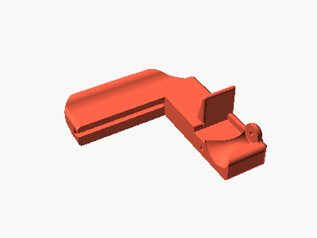
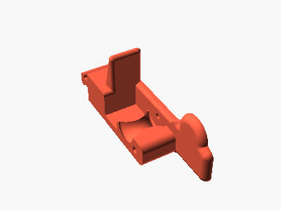
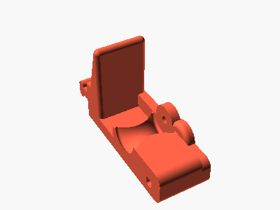
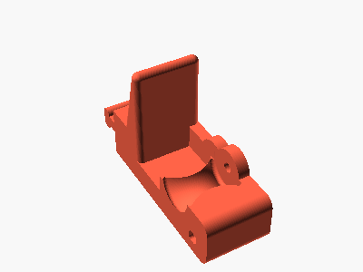
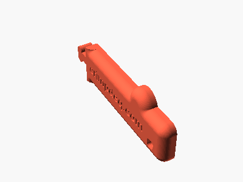
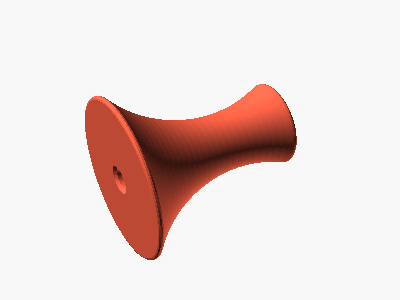
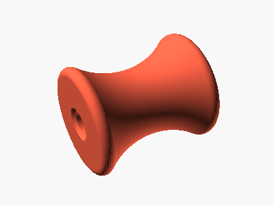
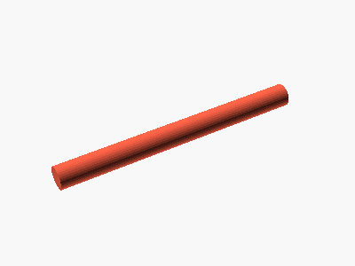
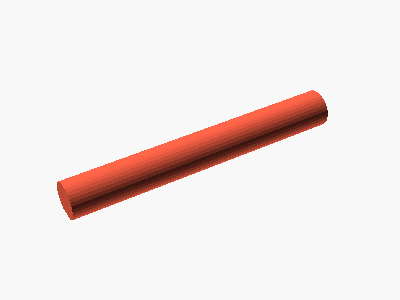
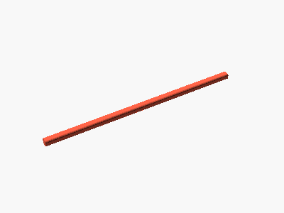

# Parts

How to put together a printed Prometheus grip, such as
`prometheus-fit/examples/right-hand/prometheus_right_A1.3mf`. The pictures show that right-hand grip; a
left-hand grip is its mirror image and goes together the same way.

You need the 14 printed parts, a cord for the anchor, and a mallet or hammer with a small wood
block.

The middle and index walls look alike: label them as you take them off the plate (the slicer's
object list names every part).

| Part | | How to recognize it |
|---|---|---|
| Frame |  | The largest part, with the top crossbar and the cord hole |
| Ring wall |  | Round hump around a pin hole |
| Middle wall |  | Looks like the index wall |
| Index wall |  | Looks like the middle wall |
| End wall |  | Thin plate engraved `crimpdeq.com` |
| Pinky roller |  | 30 mm, one narrow and one wide end |
| Ring, middle and index rollers (3) |  | 19 mm, both ends the same |
| Pinky pin |  | The longer pin, about 36 mm |
| Ring, middle and index pins (3) |  | About 25 mm, interchangeable |
| Post |  | Long square bar, about 105 mm, one corner chamfered |

The illustrations come from the OpenSCAD model; regenerate them with `./render.sh`.
