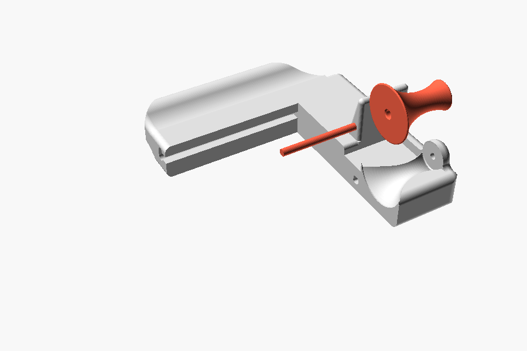
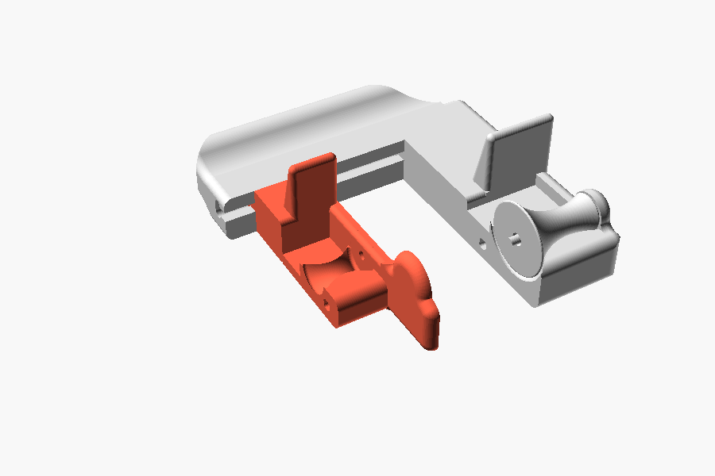
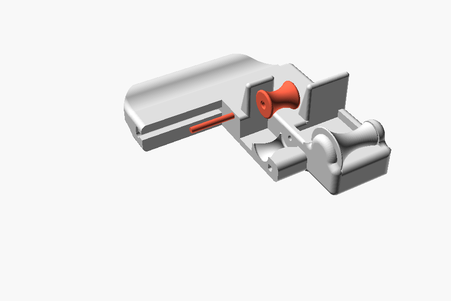
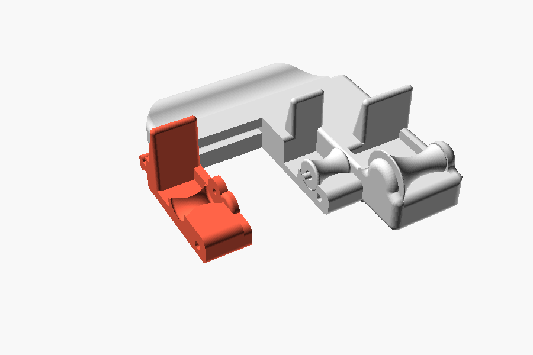
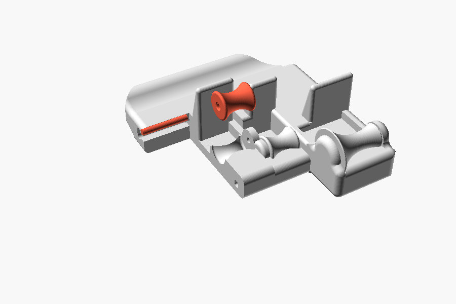
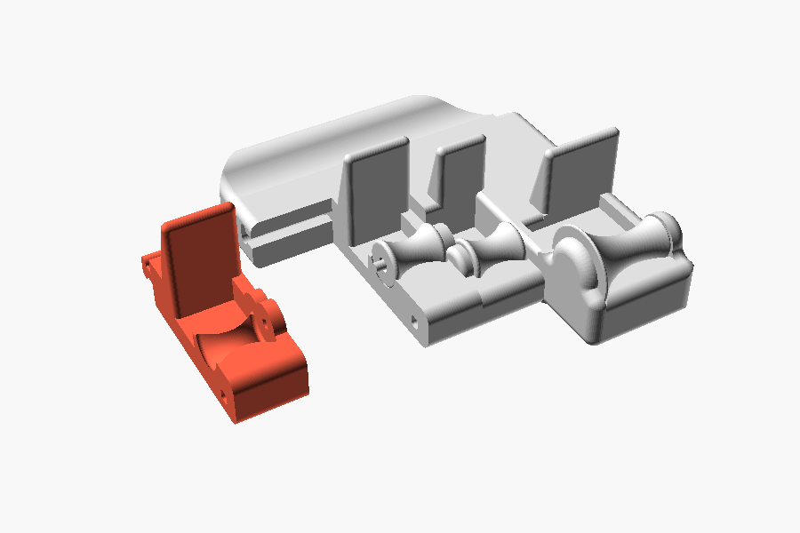
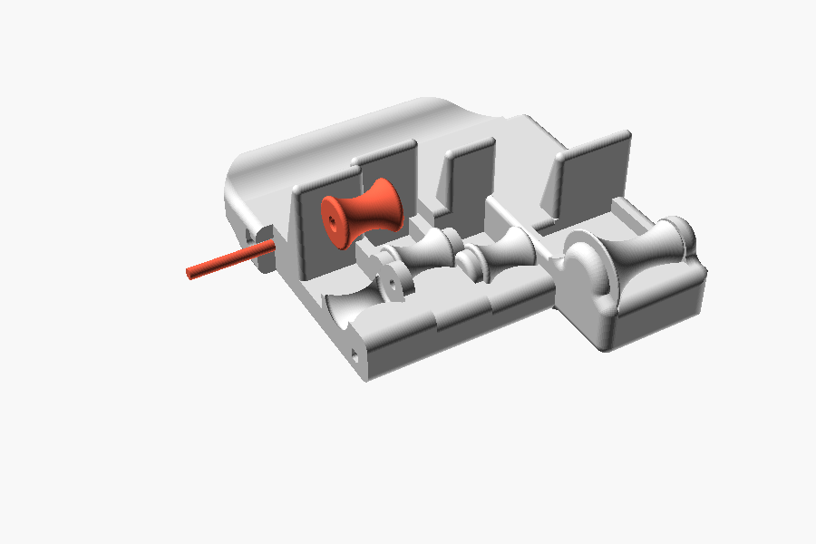
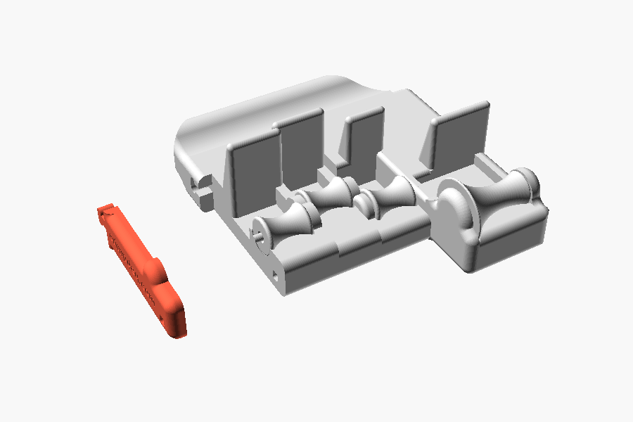
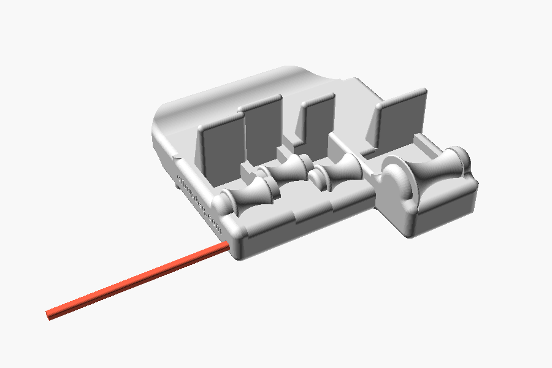

# Assembly

Build from the pinky side to the index side. Walls slide into the slot in the frame's crossbar
from its open end, along the roller axis; they cannot drop in from above. Each pin rests in a
hole in the wall on both sides of its roller.

## 1. Pinky roller and pin

Lay the pinky roller in the frame, narrow end against the frame's outer wall. Push the long pin
through it into the frame's hole; about 3 mm sticks out.

## 2. Ring wall

Slide the ring wall into the crossbar slot and push it along until the pinky pin enters its hole
and the wall sits against the roller.

## 3. Ring roller and pin

Lay the ring roller on the ring wall and push a short pin through it into the wall.

## 4. Middle wall

Slide it in like the ring wall, onto the ring pin.

## 5. Middle roller and pin

## 6. Index wall

## 7. Index roller and pin

## 8. End wall

Slide it in last, onto the index pin, engraving facing out.

## 9. Post

Turn the post so its chamfered corner matches the corner of the square hole. Push it through
the end wall and every other wall into the frame until it sits flush with the end wall.

## 10. Cord

Thread the cord through the round hole in the frame's anchor, behind the crossbar.

## If something does not fit

- The wall tongues fit their slot with no clearance. Tap the walls home with the mallet over the
  wood block. If one will not move, sand its tongue instead of forcing it.
- Pins, rollers and the post have clearance: every roller should spin freely and nothing should
  rattle.
- Finally, hold the grip: each fingertip should rest on its roller with the last finger joint
  against the block above it.
